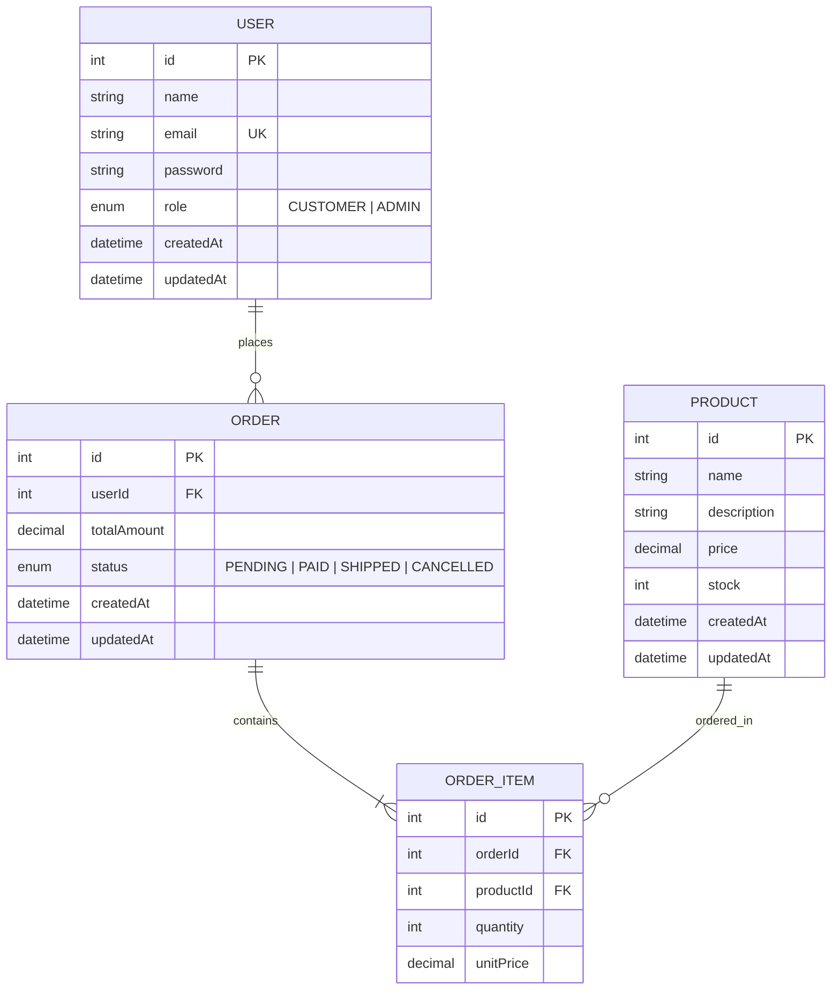

# 📋 Technical Assessment & Project Specification: RESTful API Engine
**Position:** Junior / Mid-Level Backend Engineer  
**Standard:** Enterprise / Production-Ready  
**Evaluation Model:** Take-Home Coding Challenge  

---

## 1. Executive Summary & Business Background

Sebuah startup logistik & e-commerce terkemuka ingin merilis modul backend generasi baru untuk mengelola **Order & Inventory Management System**. Sistem ini harus menangani multi-user dengan hak akses berbeda (**Customer** vs **Admin**), menjaga integritas stok barang secara realtime, serta menyediakan riwayat transaksi yang akurat.

Tugas Anda adalah merancang, mengimplementasikan, dan mendokumentasikan RESTful API engine ini menggunakan standar clean architecture modern berbasis TypeScript.

---

## 2. Project Scope & Requirements

### A. Role-Based Access Control (RBAC)
Sistem memiliki 2 level aktor:
1. **CUSTOMER**:
   - Dapat mendaftar & login.
   - Dapat melihat profil & memperbarui informasi pribadi.
   - Dapat melihat katalog produk publik.
   - Dapat membuat pesanan (Checkout / Create Order) jika stok tersedia.
   - Hanya dapat melihat riwayat pesanannya sendiri.
2. **ADMIN**:
   - Memiliki semua kemampuan Customer.
   - Dapat menambah, mengedit, dan menghapus produk (CRUD Product).
   - Dapat melihat seluruh transaksi order dari semua user.
   - Dapat mengubah status pesanan (`PENDING` -> `PAID` -> `SHIPPED` -> `CANCELLED`).

---

### B. Core Features & Business Logic Rules

1. **Authentication & Security**:
   - Password wajib di-hash menggunakan `bcrypt` (Salt Rounds 10).
   - Login menerbitkan `JWT Token` (Access Token berlaku 1-24 jam).
   - Endpoint terlindungi wajib memvalidasi token via HTTP Header: `Authorization: Bearer <token>`.
   - Role Guard: Rute Admin wajib menolak Customer dengan response `403 Forbidden`.

2. **Inventory & Order Transaction Integrity**:
   - Saat checkout order dibuat, sistem wajib memastikan stok produk mencukupi.
   - Stok barang harus berkurang secara otomatis.
   - Wajib menggunakan **Database Transaction** (`prisma.$transaction`) agar jika salah satu item gagal, seluruh order di-rollback (tidak ada data menggantung / corrupt).

3. **Input Validation & Error Handling**:
   - Seluruh payload request (Body, Query, Params) wajib divalidasi ketat menggunakan schema **Zod**.
   - Global Error Handler terpusat: Tidak ada *unhandled rejection* atau *server crash*.
   - Standar response JSON yang konsisten.

---

## 3. Database Design & Entity Relationship (ERD)



---

## 4. API Specification & Contract

Semua response wajib mengikuti format standar berikut:

- **Success Response:**
```json
{
  "success": true,
  "message": "Deskripsi singkat hasil",
  "data": {} // atau []
}
```

- **Error Response:**
```json
{
  "success": false,
  "error": "Pesan error spesifik",
  "details": [] // Opsional jika dari Zod validation
}
```

### Endpoints Table

| Method | Endpoint | Auth | Role | Deskripsi |
| :--- | :--- | :--- | :--- | :--- |
| **POST** | `/api/auth/register` | Publik | - | Mendaftar user baru |
| **POST** | `/api/auth/login` | Publik | - | Login & mendapatkan JWT token |
| **GET** | `/api/users/profile` | Bearer | All | Melihat profil user saat ini |
| **GET** | `/api/products` | Publik | - | Menampilkan katalog produk (dengan pagination/filter) |
| **GET** | `/api/products/:id` | Publik | - | Detail spesifik produk |
| **POST** | `/api/products` | Bearer | ADMIN | Menambah produk baru |
| **PUT** | `/api/products/:id` | Bearer | ADMIN | Update detail / stok produk |
| **DELETE**| `/api/products/:id` | Bearer | ADMIN | Menghapus produk |
| **POST** | `/api/orders` | Bearer | CUSTOMER | Checkout pesanan (Atomic Transaction) |
| **GET** | `/api/orders/my-orders`| Bearer | CUSTOMER | Riwayat pesanan milik user sendiri |
| **GET** | `/api/orders` | Bearer | ADMIN | Menampilkan semua pesanan seluruh user |
| **PATCH**| `/api/orders/:id/status`| Bearer | ADMIN | Update status pesanan |

---

## 5. Industrial Architecture & Folder Structure Standard

Proyek wajib mengadopsi **Clean Modular Architecture**:

```text
capstone_myself/
├── prisma/
│   ├── schema.prisma        # Database schema & migrations
│   └── migrations/
├── src/
│   ├── config/              # Environment & configuration helpers
│   ├── controllers/         # HTTP request/response handlers
│   ├── errors/              # Custom AppError & domain exceptions
│   ├── middlewares/         # authGuard, roleGuard, errorHandler, logger
│   ├── routes/              # Express Router definitions
│   ├── services/            # Pure Business logic & DB transactions
│   ├── validation/          # Zod schema definitions
│   ├── types/               # TypeScript global declarations (.d.ts)
│   ├── app.ts               # Express application initialization
│   └── server.ts            # Entrypoint listener & graceful shutdown
├── .env.example             # Template konfigurasi environment
├── docker-compose.yml       # Database infrastructure container
├── README.md                # Dokumentasi setup & instruksi pengujian
├── tsconfig.json
└── package.json
```

---

## 6. Evaluation Criteria (Rubrik Penilaian Perusahaan)

1. **Architecture & Clean Code (25%)**:
   - Pemisahan tanggung jawab yang jelas (Controller hanya mengurus HTTP, Service mengurus Database & Logic).
   - Penamaan variabel, fungsi, dan file yang ekspresif.
2. **Security & RBAC Implementation (25%)**:
   - Keamanan hashing password dan validasi token JWT yang ketat.
   - Tidak ada kebocoran data sensitif (password hash tidak pernah kembali ke JSON).
   - Role guard yang tidak bisa di-bypass oleh Customer biasa.
3. **Data Integrity & Concurrency (25%)**:
   - Penggunaan Prisma Transaction saat checkout.
   - Validasi stok tidak boleh minus.
4. **Error Handling & Validation (15%)**:
   - Respon status code HTTP tepat (200, 201, 400, 401, 403, 404, 409, 500).
5. **Documentation & Deliverables (10%)**:
   - File `README.md` yang siap dibaca oleh tim penguji.
   - File Postman Collection / OpenAPI Spec untuk memudahkan review.
